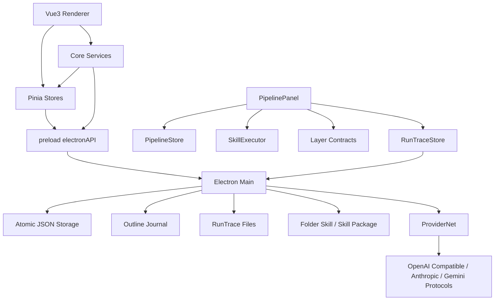
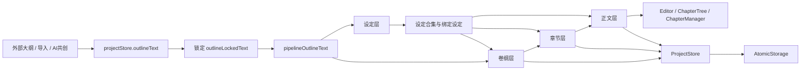

# 神意助手全维度摸底文档 V3.128

> 审查对象：D:\codex\novel-workshop-vue3
> 当前版本：3.128.2
> 审查方式：当前源码静态全链路解析，重点覆盖工程结构、状态、流水线、SKILL、Agent、供应商网络、正文生成、去AI、记忆、IPC、UI、测试与 Codex 机制融入点。
> 结论口径：本文档描述“当前源码实际结构”，不依赖 3.118 旧版说明。文中所有行号均来自当前源码。
> 补记口径：第 9.10、10.2、14.5、25、27 节记录 2026-11-15 后已合入的现役语义；历史 trace、payload 和带日期报告只作证据，不作为现役合同。

## 1. 一句话内核

神意助手以“项目态 + 锁定大纲 + 五层生成流水线 + 层级契约 + SKILL/Agent 可插拔执行 + 本地持久化 + RunTrace”为核心。大纲锁定后成为下游统一事实源，设定、卷纲、章节、正文逐层物化；层与层之间不靠自由聊天承接，而是靠结构化产物、验收器、合同、断点、重试和追踪事件保障可复跑。

## 2. 摸底范围

已解析的完整范围包括：

1. 工程根目录、启动脚本、构建配置、依赖清单。
2. src/App.vue 主界面装配与启动加载链。
3. 全部 Pinia Store：project、pipeline、runTrace、provider、agent、skill、editor、chat、deai、settings、theme、mcp、coCreation、aiTaskStore、executionLog 等。
4. 五层生成链路：大纲、设定、卷纲、章节、正文。
5. PipelinePanel.vue、OutlineWorkspace.vue、ChatPanel.vue、EditorPanel.vue 等大型组件的入口函数与状态流。
6. SkillRouter、SkillOrchestrator、RealSkillExecutor、FolderSkill、SKILL 包安装、SKILL 脚本执行、SKILL 校验。
7. AgentOrchestrator、WorkspaceSkillEngine、ChainExecution、ChainIntentRouter、对话工具面。
8. 供应商协议、适配器、调度器、主进程网络桥、流式帧、AbortController、软失败分类。
9. 正文长文档生成：FinalDraftService、FinalDraftRunner、LongDocumentExecutionPlanner、checkpoint、分段、重叠、重试。
10. 合同与验收：volumeGenerationContract、chapterGenerationContract、bodyArtifactContract、stepArtifactAcceptance、bodyArtifactOrchestrator、FACT_LOCK 对账。
11. DE-AI：de-ai.js V2/V3、检测报告、硬规则模式、VoiceProfile、GuidancePack、StageDiagnosis、CalibrationLedger、ModelProfile。
12. 记忆与上下文：MemoryExtractor、MemoryMerger、TrackingStateService、ConversationContextService、ContextBudget、ContextConflictDetector。
13. Electron 主进程、preload、存储原子写、大纲日志、RunTrace、SKILL 加载、SKILL 包、网络桥、诊断、Agent 状态、意图语料和向量。
14. UI 全面板与组件组织。
15. 测试脚本、服务单测、Electron 集成验证、依赖巡检。

## 3. 版本与运行

- 应用名：shenyi-assistant，中文名“神意助手”。
- 版本：3.128.2，见 package.json。
- Electron：33.4.11。
- Vue：3.5.44，Pinia：4.0.2，Vite：8.2.1，TypeScript：5.7.3。
- 主要依赖：@antv/g6、@huggingface/transformers、@node-rs/jieba、idb、marked、shiki、vue-router、vue-virtual-scroller、dompurify、electron-log。
- 启动器：start-electron.bat。
- 启动器逻辑：
  1. 切到项目目录。
  2. 检查 node_modules\electron\dist\electron.exe。
  3. 若 dist-renderer\index.html 不存在，执行 npx vite build。
  4. 启动 Electron，并打开远程调试端口 9227。
- package.json 脚本：
  - npm run start：Electron 启动。
  - npm run dev / dev:electron：Electron 开发模式。
  - npm run build:vue：构建主 renderer 和 protocols renderer。
  - npm run build：主 renderer + protocols + electron-builder Windows 打包。
  - npm run type-check：vue-tsc。
  - npm run test:services：Vitest 服务层测试。
  - npm run verify:production-wiring：dependency-cruiser 检查生产接线。
  - 一批 verify:* 脚本用于意图嵌入、供应商通道、打包、章节合同、大纲旧数据恢复、DEAI 阶段指导等专项验证。

## 4. 顶层目录与职责

| 路径 | 职责 |
|---|---|
| electron/ | Electron 主进程、preload、IPC 域实现 |
| src/components/ | Vue 组件，按 common/chat/editor/memory/naming/pipeline/settings/sidebar/dashboard/deai 分域 |
| src/services/ | 核心业务服务、合同、验收、执行器、生成器、路由器、检测器 |
| src/stores/ | Pinia 状态中心 |
| src/composables/ | Vue 组合式逻辑，AI 命名、去AI、配置交换、编辑任务、窗口拖宽、快捷键等 |
| src/workers/ | Web Worker：outline markdown 渲染、RunTrace 导出 |
| src/utils/ | storage key、markdown、节流渲染、可克隆快照 |
| src/types/ | AI 命名、上下文、G6、记忆类型 |
| docs/ | 应用与流水线历史/当前文档 |
| memory/ | 项目级记忆规则 |
| lessons/、_audit/ | 开发经验、错误与审计记录 |
| resources/models/bge-small-zh-v1.5 | 本地意图向量模型资源 |

工程规模：

- src 与 electron 共 625 个源码/测试文件。
- PipelinePanel.vue 约 374KB。
- OutlineWorkspace.vue 约 301KB。
- ChatPanel.vue 约 229KB。
- runTrace.ts 约 125KB，runTrace.spec.ts 约 157KB。
- aiService.ts 约 191KB。
- src/services 下有大量同名 .spec.ts，合同与服务层以单测为主要质量防线。

## 5. 全局运行时图



## 6. 数据模型与持久化

### 6.1 项目事实源

核心位置：src/stores/project.ts。

关键字段：

| 字段 | 行号 | 语义 |
|---|---|---|
| outlineText | src/stores/project.ts:534 | 当前可编辑大纲 |
| outlineLocked | src/stores/project.ts:535 | 大纲是否锁定 |
| outlineLockedText | src/stores/project.ts:536 | 锁定时的冻结文本 |
| bookWordCountChars | src/stores/project.ts:537 | 全书字数，字符口径 |
| schemaVersion | src/stores/project.ts:546 | 当前 Schema v4，常量在 :38 |
| styleProfile | src/stores/project.ts:559 | 文风画像 |
| settingsCollection | 后续字段区 | 设定合集 |
| volumes | 后续字段区 | 卷纲集合 |
| chapters | 后续字段区 | 章节集合 |
| pipelineConfig | 后续字段区 | 分层字数与配置 |

关键函数：

- loadProjectList()：src/stores/project.ts:690。
- loadProject(id)：src/stores/project.ts:715，读项目、迁移 schema、恢复 outline journal、恢复文风画像。
- saveProject()：src/stores/project.ts:854，序列化多个 key，经 IPC 写入并返回失败 keys。
- setOutline(text)：src/stores/project.ts:1097。
- lockOutline()：src/stores/project.ts:1102，冻结文本并调用 ensureVolumesFromOutline()。
- unlockOutline()：src/stores/project.ts:1109。
- pipelineOutlineText：src/stores/project.ts:1114，锁定时返回 outlineLockedText，否则返回 outlineText。
- ensureVolumesFromOutline()：src/stores/project.ts:1120，从大纲结构恢复卷骨架。
- appendSettingsToCollection(items)：src/stores/project.ts:1661，把设定层产物写入设定合集。

### 6.2 文风画像

- 文风画像随项目态保存。
- profileVersion 支持 V2。
- updateStyleProfileDraft 和 applyStyleProfileDraftPatch 都尊重 locked 状态，锁定后不能静默改写。
- applyAiStyleAnalysis 可把 AI 分析结果写入 styleTags 等字段。
- 文风画像与 DEAI VoiceProfile 是两个概念：
  - styleProfile：项目级文风风格画像。
  - DeaiVoiceProfile：正文生成阶段注入的去AI/口吻指导。

### 6.3 主存储：Electron atomic JSON

核心位置：electron/ipc/storage.js。

- 数据目录可由 SHENYI_DATA_DIR 控制。
- 存储键统一 wa_ 前缀，项目键形如 wa_project_{id}。
- safeKey() 过滤非法文件名字符。
- writeQueues 保证同一 key 的写入按队列串行。
- atomicWriteJson()：
  1. 写临时文件。
  2. 已有主文件先 rename 到 .bak。
  3. 临时文件 rename 到主文件。
  4. rename 失败时尝试从 .bak 恢复。
- storage:read：
  1. 若主文件缺失，先 recoverBakIfPrimaryMissing()。
  2. JSON 解析失败时读 .bak，恢复并记录 corruption log。
  3. 支持 legacyDir 兼容迁移。
- storage:write / remove / list / export / import / getDataDir / openDataDir 都注册为 IPC。
- corruption log 只保留最近 50 行，避免无限增长。

### 6.4 大纲工作台日志

核心位置：electron/ipc/outlineJournal.js。

- schema：shenyi.outline-journal，version 1。
- snapshot 带 checksum，checksum 由 projectId + 稳定序列化消息计算。
- 支持 append、replace、patch、remove、clear 五类 command。
- 命令先写 segment，然后内存应用；segmentCount >= 256 或 read 时 compact。
- compact 会重放所有 segment，生成新 snapshot，清空 segment。
- 提供 snapshot、migrate、flush、flushAll、restore、legacyCandidates、restoreLegacy、testFailureControl 等 IPC。
- 渲染层在 src/stores/project.ts 内有队列：
  - outlineJournalQueue。
  - pending >= 32 时自动 flush。
  - IPC 不可用时降级为 memory-only，但不阻塞主流程。

### 6.5 RunTrace

核心位置：src/stores/runTrace.ts 和 electron/ipc/runTrace.js。

- RunTrace 是全应用可观测性中心。
- Store 使用 Schema v23，内存事件上限 128，5 秒防抖落盘，Run 数量上限 20。
- 主进程提供 save、list、read、remove、export、openFolder。
- 事件覆盖 prompt-built、attempt、context-scope、memory-context、chain-step、chain-handoff-delivery、body-generator-step、contract-review、deai、write、failed 等。
- RunTraceDiffPanel 可对比两次 Run 的 API 调用、提示快照、物理调用和工具调用。
- runTraceDiff.ts 负责结构化 diff。
- RunTraceExportWorkerService/worker 负责导出重活，避免 UI 卡死。

### 6.6 断点与恢复

- src/stores/pipeline.ts:276 saveBreakpoint()。
- src/stores/pipeline.ts:289 refreshBreakpoint()。
- src/stores/pipeline.ts:304 refreshBreakpointFromStorageKey()。
- src/stores/pipeline.ts:315 clearBreakpoint()。
- 非 chapters 断点按 ownerKey 存储，形如 wa_pipeline_breakpoint_owner_*。
- 默认断点 key 为 wa_pipeline_breakpoint。
- 章节层额外有 chapterProgress 与批次台账。
- 应用关闭时 App.vue 通过 shutdownApplication 取消活跃任务并做状态完整性检查。

### 6.7 数据流转总图



## 7. 主界面与启动

### 7.1 App.vue

- 主布局：SidebarNav + BreadcrumbBar + ChapterTree + EditorPanel + ChatPanel。
- 覆盖面板：SettingsModal、PipelinePanel、OutlineWorkspace、MemoryPanel、DashboardModal、PluginMarket。
- 状态横幅：保存失败、Renderer 恢复提示、安全模式。
- 全局弹层：InlineMenu、SkillBindModal、AgentProgressPanel、AiNamingModal、ToastViewport、HelpGuide、ExitConfirmModal、AppConfirmModal。
- 状态栏显示连接、模型、章节、字数。
- 启动时并行加载：
  1. settingsStore.loadSettings()
  2. themeStore.init()
  3. providerStore.loadProviders()
  4. agentStore.loadAgents()
  5. skillStore.loadSkills()
  6. deAiStore.loadConfig()
  7. projectStore.loadProjectList()
- 随后恢复 wa_lastProjectId、wa_lastSession、存储损坏日志。
- 注册全局事件：generate-body、insert-text、show-skill-binding、ai-naming-insert。
- 多窗口支持：windowGetInitialProjectId 和 windowSetCurrentProject。
- 关闭前调用 runTraceStore.checkStateIntegrityBeforeClose() 和 shutdownApplication()。

### 7.2 主要导航面板

| activePanel | 组件 | 职责 |
|---|---|---|
| settings | SettingsModal | API、Skill、Agent、外观、去AI、诊断、MCP |
| pipeline | PipelinePanel | 五层生成流水线 |
| outline-workspace | OutlineWorkspace | 大纲导入、编辑、AI共创、锁定 |
| memory | MemoryPanel | 人物、关系、时间线、图分析 |
| dashboard | DashboardModal | 写作仪表盘 |
| plugin-market | PluginMarket | 插件/技能市场 |

## 8. 大纲工作台

### 8.1 职责

OutlineWorkspace.vue 是大纲工作台，负责：

1. 从文件导入大纲。
2. 粘贴或编辑大纲。
3. AI 共创、批量生成、改写。
4. 大纲结构解析与完整性守卫。
5. 大纲日志恢复。
6. 保存流恢复草稿。
7. 文风分析。
8. Skill 与 Agent 配置。
9. 锁定大纲并同步流水线。

### 8.2 关键函数

| 函数 | 行号 | 说明 |
|---|---|---|
| syncOutlineMessageFollowState | src/components/common/OutlineWorkspace.vue:572 | 同步消息滚动跟随 |
| startOutlineRun | :1146 | 启动大纲运行上下文 |
| startOutlineApiCall | :1968 | 启动大纲 API 调用 |
| handleStyleAnalysisRequest | :2764 | 触发文风分析 |
| saveOutlineStreamRecoveryDraft | :3196 | 保存流恢复草稿 |
| handleDiffLocate | :3712 | diff 定位 |
| handleAgentChange | :3725 | 更换 Agent |
| handleModeChange | :3745 | chain/compose 模式切换 |
| handleSkillAgentChange | :3749 | 修改 Skill 绑定 Agent |
| handleEditorKeydown | :4137 | 编辑器快捷键 |
| handleImport | :4155 | 文件导入 |
| handleLockOutline | :4682 | 锁定大纲 |
| saveOutline | :4888 | 保存大纲 |
| handleUnlockOutline | :7138 | 解锁大纲 |

### 8.3 锁定语义

锁定不是普通编辑开关，而是事实源提交：

1. outlineText 冻结到 outlineLockedText。
2. pipelineOutlineText 切换到冻结文本。
3. ensureVolumesFromOutline() 从大纲恢复卷骨架。
4. 同步流水线树和设定抽取。
5. 保存项目态。

解锁后 outlineLocked=false，但下游已生成的卷/章不会自动清空；重新确认或重新生成时，上游事实源才会影响新产物。

### 8.4 大纲完整性守卫

服务层包括：

- outlineIntegrity.ts：结构缺失、标题丢失、正文骤减、章数爆炸、重复标题。
- outlineDeletionContract.ts 和 outlineDeletionAuthorization.ts：删除类编辑授权，防止 AI 静默吞段。
- outlineInputGate.ts：输入门禁与等待运行恢复。
- outlineStructure.ts：结构解析。
- outlineStructureSemanticIdProbe.ts：结构语义 ID 探针。
- outlineReplace.ts、outlineReplace.spec.ts：替换安全。
- outlineWorkspaceStateMachine.spec.ts：工作台状态机回归。

### 8.5 大纲 AI 共创

- 通过 startOutlineRun、startOutlineApiCall、workspaceSkillEngine 等服务路由。
- 支持意图路由：生成、改写、分析、讨论、工具调用。
- 支持多 Skill chain/compose。
- 输出经 workspaceArtifactAcceptance 和 schemaRetryFeedback 保障结构合法。
- 消息流会写入 outline journal，失败可恢复。

## 9. 生成流水线总控

### 9.1 五层定义

src/stores/pipeline.ts:38 明确：

```text
0 = outline
1 = settings
2 = volumes
3 = chapters
4 = body
```

| 层 | 名称 | 输入 | 产物 |
|---|---|---|---|
| 0 | 大纲层 | 外部/工作台大纲 | 锁定大纲 + 全书字数 |
| 1 | 设定层 | 冻结大纲 | 设定卡/设定合集 |
| 2 | 卷纲层 | 冻结大纲 + 设定 + 字数计划 | 卷纲数组 |
| 3 | 章节层 | 冻结大纲 + 设定 + 当前卷纲 + 历史事实 | 章节数组 |
| 4 | 正文层 | 章节执行包 + 单元闭包 + 记忆/前章概要 + 文风/去AI指导 | 章节正文 |

### 9.2 PipelineRunRegistry

src/stores/pipeline.ts 中：

- registry = new PipelineRunRegistry()。
- runs、activeRuns、isGenerating、generationStatus 都是响应式计算。
- startGeneration() 在 :86 创建 Run；如果同层已有运行，状态为 queued。
- finishGeneration() 在 :128 成功结束并激活排队任务。
- failGeneration() 在 :139 失败结束并激活排队任务。
- cancelGeneration() 在 :157 取消；只有 running 取消才释放层槽位。
- cancelAllActiveRuns() 用于应用关闭或全局取消。
- waitForRunActivation() 等待 Run 从 queued 转为 running。
- 每层有 activeSettingsRun、activeVolumesRun、activeChaptersRun、activeBodyRun。
- isTargetGenerating(layer,target) 支持按卷/章精确判断。

### 9.3 Run 进度通道

- RunProgressChannel 处理 progress event。
- 没有 runId 的 progress event 会被拒绝并记录迁移错误，禁止误挂到最近 Run。
- reportProviderQueue() 把供应商排队事件映射为 Run progress：
  - queued：等待供应商槽位。
  - started：已获得槽位。
  - canceled：等待槽位时取消。

### 9.4 步骤配置

- mutateStepConfig()：src/stores/pipeline.ts:341，所有配置写入走串行事务队列。
- readStepConfigSnapshot()：:354。
- writeStepConfig()：:366。
- setStepSkills(step,skillIds)：:397。
- getStepSkills(step)：:403。
- setStepAgents(step,agentId)：:412。
- getStepAgents(step)：:417。
- setStepModes(step,mode)：:422。
- getStepModes(step)：:427。
- updateStepConfig(step,patch)：:432，一次 patch 更新 agent、skills、mode、skillAgent。
- readStepConfig(step)：:467。

配置存储 key：wa_pipeline_step_config。

写入时对 agents、skills、modes、skillAgents 做 per-step map merge，避免浅覆盖导致丢配置。每个 touched step 会补齐完整默认值，避免 unset 与显式空值混淆。

### 9.5 PipelinePanel 五层链路

PipelinePanel.vue 是流水线主界面。

- confirmStep()：src/components/pipeline/PipelinePanel.vue:4063。
- runStepSkills()：:4417。
- runStepSkills 重载支持 step 1/2/3 和 step 0/1/2/3，返回 string 或 StructuredSkillStepOutput。

PipelinePanel 当前实际运行链不再是旧文档里的纯函数调用，而是：

```text
UI 输入 -> confirmStep -> lock/分配字数 -> 下层生成入口
生成入口 -> provider channel snapshot -> runStepSkills -> SKILL/Agent 链
SKILL 输出 -> schemaValidation -> artifact acceptance -> ProjectStore 写入
```

### 9.6 大纲层

- 输入 outlineText。
- 用户填 bookWordCount。
- 确认时若未锁定则触发锁定。
- bookWordCountChars 保存到项目态。
- 后续卷纲层通过全书字数、卷数、章节字数做字数分配校验。

### 9.7 设定层

- 输入 pipelineOutlineText。
- 生成前可绑定设定合集。
- 生成后通过 settingsArtifactContract 和 settingsArtifactOrchestrator 做结构化验收。
- src/services/settingsLayerSemantics.ts 定义 SETTINGS_PROJECTION_POLICY_VERSION=2 和语义分类。
- buildSettingsLayerProjection() 在 :178，SETTINGS_PROJECTION_BUDGETS 在 :40。
- 下游卷纲、章节、正文分别按预算拿语义投影，而不是把全部设定原文硬塞进 prompt。
- appendSettingsToCollection() 把产物落盘到设定合集。

### 9.8 卷纲层

合同在 src/services/volumeGenerationContract.ts。

- VolumeContractMode：auto、single、continue。
- VolumeContractSemantics 必填：
  - readerExpectations 读者期待契约。
  - mainPlotLine 主推线契约。
  - unlockMilestone 解锁里程碑。
  - forbiddenFinalCards 禁碰终局底牌。
  - contractRisk 契约风险。
- validateVolumeBatch() 校验：
  - 卷数数量。
  - 卷名。
  - 卷纲内容。
  - allocatedWords/suggestedWords 非负整数。
  - 语义字段完整。
  - 历史卷名重复。
  - 本批卷名重复。
- buildVolumeHistoryFacts() 和 renderVolumeHistoryContext() 输出已生成卷事实清单，避免重复生成。
- validateVolumeGenerationLedger() 校验整体台账目标数。

批量提示在 src/services/volumeBatchOrchestrator.ts。

- buildVolumeBatchPromptWithAudit()：:93。
- buildVolumeBatchPrompt()：:180。

### 9.9 章节层

合同在 src/services/chapterGenerationContract.ts。

- ChapterBatchContract：volumeId、batchIndex、expectedStart、expectedEnd、requestedCount、totalChapters。
- extractDeclaredChapterCount() 从卷纲文本提取“承载/共/规划/定稿 N 章”。
- resolveChapterCountContract() 优先级：
  1. volume_outline_declared：卷纲声明章数优先。
  2. configured_chapter_count：应用配置章数。
  3. word_estimate：分配字数 / 每章字数推算。
- validateChapterBatch() 校验数量、标题、剧情点、历史标题重复、本批标题重复、剧情概要完全重复警告。
- validateChapterGenerationLedger() 校验批次区间从 1 开始、无断档、无重叠、覆盖目标章数。
- buildChapterHistoryFacts() 输出已生成标题清单和上一章事实。
- renderChapterHistoryContext() 把历史标题与上一章事实注入 prompt。
- buildChapterBatchPrompt() 在 src/services/chapterBatchOrchestrator.ts:57。

章卡由卷纲向下传递后在章节层产生，不是大纲组成部分。这与当前合同结构一致。

### 9.10 正文层

合同在 src/services/bodyArtifactContract.ts。

- BodyArtifactContract 包含 targetWords、minimumWords、maximumWords 等字段。
- countBodyWords() 统一正文字数口径。
- validateBodyArtifact() 输出 min/max 校验结果。

验收在 src/services/stepArtifactAcceptance.ts。

- resolveStepArtifactFlow() 是核心入口。
- StepArtifactCallerStatus：success、degraded、failed、blocked。
- acceptance.reason：
  - no_contract
  - no_contract_degraded
  - contract_valid
  - contract_failed
  - caller_failed
- 决策：
  - caller failed 直接拒绝。
  - degraded 且无合同时拒绝。
  - degraded 且合同失败时拒绝。
  - 合同通过时接受。
- 从元数据 extractedMeta 中抽取 FACT_LOCK。
- FACT_LOCK 支持三种格式：
  - FACT_LOCK:key=value
  - FACT_LOCK:key:value
  - FACT_LOCK 块尾行 key:value
- resolveFinalStepMetadataFlow() 对比 S2 权威账本与终稿账本：
  - matched
  - missing_in_final
  - conflicting
  - conflictTypes: label_drift / body_divergence
  - body_divergence 会报 warning。
  - 无正文分歧时允许终步账本退化回填。
  - 生成器账本缺失时禁止伪造通过。

失败修复在 src/services/bodyArtifactOrchestrator.ts。

- resolveBodyStructuredFailure()：:87。
- recordBodyArtifactPostProcess()：:155。
- planBodyArtifactExecution()：:191。
- buildPrompt()：:231。
- buildTraceAuditFields()：:270。
- buildDecisionPath()：:286。
- 策略区分 targeted repair 和 full chain。
- chapterEventDensity.ts 提供事件增量 advisory 和叙事 verdict。

#### 9.10.1 现役输出与解析合同

- 正文生成合同句由 src/services/chainExecution.ts:53 的 `bodyGeneratorContractSentence()` 生成，合同句明确要求“输出现役 LHC JSON 信封：正文本体放进 body；交接账本放进 metadata.extractedMeta[0]”。
- src/services/generationResult.ts:38 的 `parseGenerationResult()` 先走 JSON 信封解析，`body` 不是字符串或 JSON 解析失败时才回退 legacy 正文+元数据拆分。
- JSON 信封内的 `body` 仍会再做 legacy 标记拆分；拆出的区块会并入 `metadata.extractedMeta`，因此 S2/S3 现役产物是 LHC 信封，S1 骨架仍可保留 legacy 字符串形态。
- 诊断正文层时必须区分信封 `body`、`metadata.extractedMeta` 与原始文本；不能把整个 JSON 原文当成正文计数。

#### 9.10.2 结构化失败与终态恢复

- `runStepSkills()` 的重载在 src/components/pipeline/PipelinePanel.vue:4417 区分 step 1/2/3 字符串返回与链式结构化返回。
- 正文链内非 success 结果会在 PipelinePanel.vue:4949 进入 `resolveStepArtifactFlow()`，并在 PipelinePanel.vue:4987 附近直接返回结构化 `callerStatus`，不再降级为字符串伪装 success。
- src/services/bodyArtifactOrchestrator.ts:87 的 `resolveBodyStructuredFailure()` 消费结构化失败与 blocking gate，用于 targeted/full-chain 修复裁决。
- 终步账本入口在 PipelinePanel.vue:5183；src/services/stepArtifactAcceptance.ts:312、:326 会在权威账本缺失或提取为 0 项时输出 `generator_ledger_missing`，禁止 0-0-0 vacuous pass。
- src/stores/runTrace.ts:748 的 `folderDiagnosticsStatus()` 采用尾部恢复语义：旧 failed 后出现后续 success 属恢复证据；尾部 failed/blocked 才是活失败。
- src/services/pipelineRunOutcome.ts:38 的终态裁决仍保持失败优先；最终产物通过不能覆盖活失败。历史失败必须在同一目标恢复后由尾部诊断翻转。

#### 9.10.3 Folder-chain 输出协议边界

- src/services/chapterBatchOrchestrator.ts:40 和 src/services/volumeBatchOrchestrator.ts:72 都有 folder-chain 任务边界声明。
- 两个批次编排器支持 `outputProtocol: 'folder-chain' | 'direct-json'`；folder-chain 模式会剥离调用方的 JSON 数组输出协议指令，替换为任务边界与事实约束。
- 该机制用于防止“应用要求输出 JSON”与 SKILL 模板“禁止输出 JSON”发生协议冲突。直接 JSON 模式不受此剥离影响。

#### 9.10.4 失败拓扑与恢复收口

- 失败上游不得进入 targeted 修复。failed/blocked 产物只有携带现役 LHC 信封 `body` 时才可能被判为可修复正文；S1 legacy 骨架与非空失败字符串不满足该条件，一律路由 full_chain。
- 失败步骤的 `extractedMeta` / FACT_LOCK 不继承为权威账本。生成步权威账本只来自 callerStatus 为 success/degraded 且 artifact acceptance 接受的产物；断点恢复路径按 `ChainBreakpointStepOutput.callerStatus` 过滤，旧断点缺字段时保守拒绝。
- targeted 修复接受新鲜成功上游后，会同步 `completedStepOutputs`，再从最终成功产物解析权威账本；失败装配面同步清空上游 metadata 与账本。
- 正文 run 终态由结构化验收和活失败裁决决定：调用级 blocked 只在最终产物未接受时阻断；run/owning 级 blocked 仍权威。历史 failed 后出现同一目标成功恢复，标记 `recovered_from_failed`；degraded 恢复标记 `recovered_from_degraded`。
- 失败候选不得写入成功断点；成功链完成时清除断点。SCENARIO=a/c 的恢复终态是 `success_with_warnings`，SCENARIO=b 的修复耗尽终态是 failed；合同级 E2E 证据在 `_audit/verification-body-failure-topology/`。

### 9.11 执行包

- src/services/chapterExecutionPackage.ts:102 createChapterExecutionPackage()。
- :140 buildChapterExecutionPrompt(pkg)。
- 执行包把大纲、设定投影、卷纲、章节卡、上下文闭包、目标字数、文风/去AI指导组织成可复现 prompt。

### 9.12 供应商通道

- src/services/pipelineProviderChannels.ts。
- 每层可绑定独立 provider/model/agent/timeout。
- Run 启动时通过 configSnapshot 冻结通道。
- getFrozenProviderChannel() 从 Run registry 取冻结配置，避免运行中配置漂移。
- src/stores/pipeline.providerChannel.spec.ts 有回归。
- realSkillExecutor.spec.ts 验证 folder 调用优先走 layer provider，即使 Agent 存在但没有 provider binding 时也走 layer provider。

### 9.13 流水线并行

- PipelineRunRegistry 已支持同层排队。
- pipelineParallelismPhase0.spec.ts 覆盖并行 Phase 0。
- UI 通过 activeRuns 和 per-run state 区分不同任务。
- 供应商调度层再限制实际并发。

## 10. Skill 系统

### 10.1 Skill 分类

src/services/skillRouter.ts 将 Skill 分为三类：

1. text：模板注入型。
2. folder：真实文件夹 SKILL，交由 executeRealSkill() 执行。
3. composite：组合技能。

### 10.2 执行引擎

- src/services/realSkillExecutor.ts 是 folder SKILL 核心。
- folder SKILL 流程：
  1. 读取 template.md。
  2. 注入调用方变量。
  3. 执行 preProcess。
  4. 构建 prompt。
  5. 调用 AI。
  6. schema/postProcess 校验。
  7. 失败重试。
  8. 重试耗尽时保留最佳候选，但状态降级为未通过，交给上层合同门裁决。
- Skill 可带 inputSchema、outputFormat、validationRules、preProcess、postProcess、provider binding、DEAI ownership。
- schemaRetryFeedback.ts 负责把校验错误转成修复反馈。
- skillValidation.ts 提供通用校验。
- protectedSkillContract.ts 保护合同类 Skill 的输入输出。
- skillHealth.ts、skillIdentity.ts、skillAgentBinding.ts 负责 Skill 健康与身份。

#### 10.2.1 现役硬闸、预算与反馈

- 未替换占位符硬闸：src/services/realSkillExecutor.ts:679 会注入 `template-placeholder-unresolved` error，:866 因该诊断阻断请求发出；不能让字面 `{{chapterSummary}}` 流到模型。
- SKILL 版本钉死：带 pinnedFingerprint 的调用在 realSkillExecutor.ts:765 加载时阻断 `skill_version_mismatch`，:977 每次 attempt 前还会做 pin 复核；运行基准与磁盘指纹不一致时不发物理请求。
- API 物理重试预算：`createApiCallBudget()` 默认总量 8；step 入口用 `tryConsume()`，realSkillExecutor.ts:1140 会在 retry、heartbeat_retry、direct_retry、continuation 四个物理阶段调用 `consumePhysicalRetry()` 消耗共享预算。诊断耗时与“重试风暴”时必须按物理调用而非逻辑 attempt 对账。
- postProcess usage：realSkillExecutor.ts:1384 把 `usage` 与候选输出一起传入 postProcess；SKILL 可输出 `_perf`。执行器把 `_perf` 归一为 warning、thresholdNotMet、usageUnavailable 三态。
- schema retry 四策略：src/services/schemaRetryFeedback.ts:20 定义 bounded-summary、word-gap、handoff-repair、candidate-anchored，并记录 `scaffoldSource: candidate/upstream/none`；策略选择要看候选是否可用，不能假设失败反馈总携带全文。

### 10.3 编排与组合

- skillOrchestrator.ts：text/folder/composite 编排。
- workspaceSkillEngine.ts：工作台级 chain/compose、意图路由、工具调用。
- chainExecution.ts：链式执行。
- chainHandoff.ts：链间交接。
- chainBreakpoint.ts：链断点。
- sourceContaminationDetector.ts：源头污染检测。
- skillGuidanceSanitizer.ts：指导清洗。

### 10.4 Folder SKILL 包管理

- electron/ipc/skill-loader.js：
  - skill:loadFolder
  - skill:listFolders
  - skill:executeScript
  - skill:openFolder
- electron/ipc/skill-package.js：
  - skillPackage:preview
  - skillPackage:install
  - skillPackage:listVersions
  - skillPackage:resolveVersion
  - skillPackage:export
  - skillPackage:openDialog
- src/services/folderSkillBatchImport.ts 支持批量导入。
- src/services/folderSkillRuntimeHydration.ts 支持运行时恢复。
- src/services/skillPackageManager.ts 管理 Skill 包元数据。
- src/services/skillPackageProtocol.json 定义包协议。

### 10.5 Pipeline 内 Skill

- PipelinePanel 每层可绑定多个 Skill。
- 每层 mode 支持 chain/compose。
- 每个 Skill 可绑定独立 Agent。
- runStepSkills 会传入 prompt、fallbackTemplate、executionPlan、traceRunId、pipelineRunId。
- 执行过程产生 chain-step、deai-injection-policy、deai-guidance-pack、contract-review、failed 等 RunTrace 事件。

## 11. Agent 系统

### 11.1 Agent Store

- src/stores/agent.ts。
- Agent 定义 model、temperature、systemPrompt、maxTokens、providerId 等。
- Pipeline 层和 Skill 都可绑定 Agent。
- AgentSettings.vue 管理界面。

### 11.2 AgentOrchestrator

- src/services/agentOrchestrator.ts。
- 负责对话式 Agent 任务路由。
- 与 agentTerminalMapping、agentTraceBridge、agentDialogueRuntime、agentToolConflict 协作。
- 能把任务路由到 EditTask、直接写、最终稿、讨论、分析。
- spec 覆盖 whole-document restructure、whole-document replacement、final draft 等场景。

### 11.3 WorkspaceSkillEngine

- src/services/workspaceSkillEngine.ts。
- 工作台聊天与编辑任务的执行入口。
- 路由意图到生成、编辑、分析、讨论。
- 支持 compose 和 chain。
- 与 chainIntentRouter 协作。
- workspaceArtifactAcceptance.ts 验收工作台产物。

### 11.4 ChainIntentRouter

- src/services/chainIntentRouter.ts。
- 大规模意图路由，含词料：
  - chainIntentPhraseCorpus.ts 约 96KB。
  - chainIntentEvalData.ts。
  - intentCorpusCollector.ts。
  - shadowIntentCorpus.ts。
- 支持本地意图路由、LLM fallback、embedding。
- electron/ipc/intentEmbedding.js 调用本地模型 intent:embed。
- scripts/verify-intent-embedding-node.mjs 和 verify-intent-embedding-electron.mjs 有专项验证。
- scripts/evaluate-chain-intent-router.mjs 用于评估意图路由准确率。

### 11.5 对话与编辑工具

- src/services/dialogueToolSurface.ts。
- src/services/dialogueFoundation.ts。
- src/services/dialogueFoundationContract.ts。
- src/services/editorTools.ts。
- src/services/editorEditProtocol.ts。
- src/services/editorEditService.ts。
- src/services/editorEditDiagnostics.ts。
- src/services/editorDocumentMap.ts。
- src/services/longDocumentPolicy.ts。
- src/services/longDocumentExecutionPlanner.ts。

能力覆盖：

1. AI 请求工具调用。
2. 编辑器定位、替换、插入、重排。
3. 全文档清洗/重构路由。
4. 长文档分段执行。
5. 写权限、重复写守卫、工具循环预算。

## 12. 供应商与网络层

### 12.1 供应商协议

- src/services/providerProtocols.ts。
- ProviderType 支持多协议，核心为 OpenAI compatible，另有 Anthropic/Gemini 协议处理。
- EndpointMode：auto、base、full。
- buildProviderChatUrl、buildProviderModelsUrl、buildProviderHeaders。
- redactProviderHeaders() 在日志中脱敏。
- sanitizeUrlForLog() 对 URL 脱敏。
- httpErrorMessage() 统一错误文案。

### 12.2 供应商适配

- src/services/providerAdapter.ts。
- buildChatUrl/buildModelsUrl。
- resolveModel、resolveTemperature、resolveMaxTokens。
- extractNonStreamText、extractStreamDelta。
- SSE 解析、finish reason 归一化。

### 12.3 调度器

- src/services/providerScheduler.ts。
- DEFAULT_PROVIDER_CONCURRENCY = 2。
- ProviderSchedulerSlot/ProviderQueueEvent/ProviderSchedulerSnapshot。
- 限制同一供应商并发，防止 429/限流放大。

### 12.4 主进程网络桥

- electron/ipc/api.js。
- registerApiHandlers() 在 :693。
- registerProviderNetHandlers() 在 :439。
- IPC：
  - providerNet:request
  - providerNet:stream
  - providerNet:abort
  - providerNet:heartbeat
  - providerNet:registry
  - providerNet:schedulerSnapshot
  - api:fetchModels
- providerNet:stream 使用 sender.send('providerNet:streamFrame', ...) 推流。
- createTrackedAbortController() 管理请求取消。
- heartbeat 防止 UI 长时间无反馈。

### 12.5 AI 服务

- src/services/aiService.ts。
- 核心接口 callAi(params)。
- 请求前组装 system/user。
- JSON 模式会加表格输出指导。
- 编辑器写协议有专用保护。
- 支持 Tool Call：
  - OpenAI toolCalls。
  - Anthropic content blocks。
  - Gemini functionCall。
- 有流式工具调用守卫、重复写守卫、写权限评估、兼容性写降级。
- 有首次输出超时、硬超时、取消信号合并。
- 有 soft provider error 分类。
- 有模型能力解析、上下文窗口解析、maxTokens 降级。
- apiCallBudget.ts、toolRunBudget.ts、toolRunSupervisor.ts、toolLoopPolicy.ts 控制工具调用预算与循环。

### 12.6 响应合同

- src/services/providerResponseContract.ts。
- ProviderResponseKind。
- normalizeProviderResponse() 统一响应。
- classifyProviderSoftFailure() 识别软失败。
- extractSoftProviderErrorBody() 提取错误体。
- src/services/streamContract.ts 处理流式合同。

## 13. 正文长文档生成

### 13.1 FinalDraftService

- src/services/finalDraftService.ts。
- 核心常量 FINAL_DRAFT_SKILL_GUIDANCE_CHAR_LIMIT=8000。
- createFinalDraftTask() 创建任务。
- buildFinalDraftMessages/buildFinalDraftSegmentMessages/buildFinalDraftContinuationMessages 构建分段消息。
- validateFinalDraft() 校验结果。
- generateFinalDraft() 主入口。
- continueFinalDraft() 续写。
- cancelFinalDraft() 取消。
- retryFinalDraftSegment() 重试片段。
- normalizeFinalDraftParagraphSeparators() 归一化段落分隔。
- hashContent() 与 toContinuationSnapshot() 支持续写一致性。

### 13.2 FinalDraftRunner

- src/services/finalDraftRunner.ts。
- runFinalDraft()：:192。
- continueFinalDraftTask()：:654。
- retryFinalDraftSegmentTask()：:766。
- resumeFinalDraftTask()：:908。
- createFinalDraftStatusMessage()：:1053。
- finalDraftSourceHash()：:1084。
- 分段大小支持 120-8000 字级别。
- 有 checkpoint、心跳、吞吐量遥测。

### 13.3 Long Document Planner

- src/services/longDocumentExecutionPlanner.ts。
- 根据任务类型、文档长度、目标区间、全文档是否 fit 决定：
  - local-transform
  - single-pass
  - segmented / EditTask
- longDocumentPolicy.ts 路由 whole-document cleanup/restructure。
- longDocumentWriteCoverage.ts 检查写入覆盖率。
- longDocumentWriteProtocol.ts 保证分段写入协议。

### 13.4 Checkpoint

- finalDraftCheckpoint.ts。
- finalDraftCheckpointElectron.ts。
- 可在任务中断后恢复。
- 与 RunTrace、aiTaskStore 协作。

## 14. DE-AI 系统

### 14.1 双层架构

- de-ai.js 是硬规则层 + 检测报告层。
- SKILL 链是方法论注入层。
- V2 内核已经从“直接自动改写”演进为“检测、报告、可校准、按阶段注入指导”。

### 14.2 硬规则层

- HARD_RULES：
  - cliches AI 套话安全替换。
  - connectors 连接词替换。
  - deDiReplace 的/地替换。
  - dunhaoToComma 顿号转逗号。
  - aiFreqDetect AI 高频词检测。
  - bannedVocab 禁用词检测。
  - bannedPhrases 禁用句式检测。
- 正文专用替换强调不删内容、不改句读、不引入议论腔。
- passesBodyIntegrityCheck() 保护段落、句尾标点、坏标点和 0.95-1.05 长度比例。

### 14.3 V2 检测报告

- 阈值：
  - minEffectiveChars=80
  - shortTextChars=1200
  - maxRepeatedBigram=12
  - maxRepeatedTrigram=8
  - styleDriftWindowChars=2000
  - scoreAdvisory=25
  - scoreSuspicious=45
  - scoreLikelyAi=65
  - scoreBlocking=80
- 指标：
  - sentenceLengthCV
  - hedging density
  - repeated bigram/trigram
  - style drift
  - high-confidence banned vocab
  - connector / AI freq density
- verdict：clean、advisory、suspicious、likely_ai、blocking。
- aiEditedFraction：none、light、mixed、heavy、unknown。
- V2 阈值仍标注 provisional，原因是 9 部人写作品 900 章校准后误伤率依赖作者/题材。

### 14.4 Store 与配置

- src/stores/deai.ts。
- mode：chain、split-merge、multi-step。
- hardRuleMode：legacy-auto、detect-report、deep-fix。
- version：v2/v3。
- level：light、medium、heavy。
- textType：novel、script、media。
- splitSize 默认 1000。
- lastDetectReport 会随配置持久化。
- budgetState、resumeHandle、waitBudget、extendBudget 支持中断恢复。
- processingStages 记录阶段时间线。

### 14.5 阶段指导

- deaiVoiceProfile.ts：VOICE_PROFILE_BUDGET=700。
- deaiGuidancePack.ts：GUIDANCE_MAX_ITEMS=6，CHAR_BUDGET=1200，VOICE_PROFILE_CHAR_BUDGET=700。
- deaiStageDiagnosis.ts：生成阶段诊断与格式化指导。
- deaiModelProfile.ts：按模型生成 profile，最多 3 条规则、600 字。
- deaiCalibrationLedger.ts：最多 500 entries，最少 5 个样本才推进校准。
- deaiObservationEvents.ts、deaiSharedTopics.ts、deaiSkillReport.ts 支撑观测。
- deaiGuidanceDisplay.ts 从 RunTrace 反解析 skill/app/off/unknown 状态，并合并多 trace 状态。
- 现役发布态：src/services/deaiModelProfile.ts:11 的 `DEAI_MODEL_PROFILE_RELEASED = true`。model profile 不再被硬编码 release 开关拦住；是否可用仍按校准账本样本和选择器结果判定。
- 指导包是预算截断而非全弃：`renderPack()` 按 budget 保留可放入的条目，超预算条目进入 `droppedItemIds` 并输出 `truncated`。诊断“finding 没注入”时先看 dropped/truncated，不要直接推断为全量禁用。

### 14.6 注入策略

- deai-injection-policy 决定 generation=off/app/skill 以及 guidanceOwnership=app/skill。
- deai-guidance-pack 记录实际注入条数与字符数。
- Pipeline 正文层会注入 stage guidance、voice profile、model profile。
- deai-injection-policy.spec.ts、deai-stage-guidance.integration.spec.ts、deai-voice-profile-injection.spec.ts 有回归。
- scripts/verify-deai-stage-guidance-live.mjs 支持真实供应商验证。

## 15. 记忆与上下文

### 15.1 记忆提取与合并

- src/services/memoryExtractor.ts：从文本提取人物、关系、事件。
- src/services/memoryMerger.ts：合并新旧记忆。
- src/services/memoryRetriever.ts：检索。
- src/services/memoryVersion.ts：记忆版本。
- src/services/memoryIO.ts：导入导出。
- src/services/memoryExport.ts：导出格式。
- MemoryPanel.vue 管理界面。

### 15.2 人物与追踪状态

- src/services/trackingStateService.ts。
- 记录关键事实、伏笔、人物状态。
- 与正文层 FACT_LOCK 和执行包协作。
- src/services/contextConflictDetector.ts 检测上下文冲突。

### 15.3 会话上下文

- src/services/conversationContextService.ts。
- 组装对话历史、项目事实、文档状态、工具上下文。
- src/services/contextBudget.ts 控制上下文预算。
- src/services/toolContextCompactor.ts 压缩工具上下文。
- src/services/requestContextComposition.ts 组合请求上下文。

## 16. Electron 主进程

### 16.1 主窗口

- electron/main.js。
- 单实例/多窗口逻辑。
- 每个窗口注册响应性 handler。
- registerResponsivenessHandlers(ipcMain, win)。
- 主窗口加载 dist-renderer/index.html。
- 模型资源从 resources/models/bge-small-zh-v1.5 加载。

### 16.2 IPC 域注册

electron/main.js:281 起：

1. registerCryptoHandlers()
2. registerStorageHandlers()
3. registerOutlineJournalHandlers()
4. registerDiagHandlers()
5. registerApiHandlers()
6. registerDialogHandlers()
7. registerLifecycleHandlers()
8. registerSkillLoaderHandlers()
9. registerSkillPackageHandlers()
10. registerRunTraceHandlers()
11. registerIntentCorpusHandlers()
12. registerJiebaHandlers()
13. registerIntentEmbeddingHandlers()
14. registerAgentStateHandlers()

### 16.3 preload API

- contextBridge.exposeInMainWorld('electronAPI', ...)。
- 域包括 storage、outlineJournal、dialog、clipboard、lifecycle、responsiveness、window、agentState、diag、runTrace、intentCorpus、skill、skillPackage、provider、providerNet、intent embedding。
- 所有跨 IPC 参数经过 cloneableSnapshot。
- contextIsolation 语义下 renderer 不直接接触 Node。

### 16.4 安全与加密

- electron/ipc/crypto.js 提供 safe:encrypt / safe:decrypt。
- provider headers 在日志中脱敏。
- API Key 不写入源码，由用户配置存储。
- 没有 localStorage 默认 API Key 或硬编码供应商示例。

## 17. UI 组件层

### 17.1 组件分组

| 分组 | 文件数 | 大小 | 功能 |
|---|---:|---:|---|
| common | 26 | 579.7KB | 大纲工作台、RunTrace、Memory、Skill 绑定、StyleProfile、诊断 |
| pipeline | 4 | 396.8KB | 五层流水线主界面、流程图、进度条、RunCenter |
| chat | 2 | 250.3KB | ChatPanel 和 ChatMessage |
| settings | 11 | 235.5KB | API、Skill、Agent、外观、DEAI、诊断、MCP |
| editor | 3 | 75.5KB | 编辑器、diff、outline 面板 |
| memory | 8 | 40.9KB | 人物卡、关系图、时间线、思维导图 |
| naming | 1 | 26.7KB | AI 命名 |
| sidebar | 3 | 24.9KB | 导航、章节树、Agent 进度 |
| deai | 2 | 10.8KB | 去AI流程预览与进度 |
| dashboard | 1 | 5.2KB | 仪表盘 |

### 17.2 大型组件

#### PipelinePanel.vue

- 五层流水线主界面。
- 步骤确认、字数分配、供应商通道、Skill/Agent 绑定、Run 管理、产物验收。
- 与 pipeline store、project store、runTrace store、skill store、provider store、agent store 联动。

#### OutlineWorkspace.vue

- 大纲工作台。
- 导入、编辑、锁定、解锁、AI 共创、diff、恢复、文风分析。
- 与 project store、pipeline store、skill store、agent store、deai store、runTrace store 联动。

#### ChatPanel.vue

- 通用聊天与工作台指令入口。
- 调用 agentOrchestrator/workspaceSkillEngine。
- 支持工具调用、编辑任务、生成任务、讨论。
- 有消息渲染、任务卡片、上下文注入。

#### EditorPanel.vue

- 章节编辑。
- undo/redo、搜索、替换、折叠、虚拟化、选区、diff。
- 接收正文生成插入事件。
- 与 editor store、chapter tree、ChapterManager 联动。

#### MemoryPanel.vue

- 人物、关系、事件、时间线、图分析。
- 异步加载 RelationGraph、GraphAnalysis、MindMap、TimelineView。

#### SkillSettings.vue

- Skill 增删改、绑定、测试、导入、导出。
- 支持 Folder SKILL 和 SKILL 包。
- 与 SkillSettings、RealSkillDiagnosticsPanel 协作。

#### ApiSettings.vue

- 供应商配置、模型拉取、连通性测试、流式配置。

#### DeAiSettings.vue

- DEAI 开关、模式、级别、硬规则模式、预算、校准信息。

### 17.3 全局事件

- generate-body：跳到流水线正文层。
- insert-text：编辑器插入。
- show-skill-binding：打开 Skill 绑定弹窗。
- ai-naming-insert：AI 命名插入。
- editor-undo / editor-redo / editor-save。
- chat-send。
- find-next / find-prev。
- restore-session：恢复上次卷/章。
- inline-action：编辑器选区动作。

## 18. 状态 Store 清单

| Store | 职责 |
|---|---|
| project | 项目、大纲、锁定、设定、卷、章、文风、保存 |
| pipeline | 五层步骤、Run Registry、断点、层配置 |
| runTrace | RunTrace 事件、持久化、diff、导出 |
| provider | 供应商、模型、活动 provider |
| agent | Agent 配置 |
| skill | Skill 列表与绑定 |
| editor | 标签页、内容、选中章 |
| chat | 聊天状态 |
| deai | DEAI 配置、进度、预算 |
| settings | 全局偏好 |
| theme | 主题 |
| mcp | MCP 配置 |
| coCreation | AI 共创状态 |
| aiTaskStore | AI 任务状态 |
| executionLog | 执行日志 |
## 19. 测试与验证体系

### 19.1 单元测试

- 运行命令：npm run test:services。
- 测试框架：Vitest 4.1.11。
- 服务合同层有大量同文件 spec：
  - pipeline.spec.ts
  - project.spec.ts
  - runTrace.spec.ts
  - aiService.spec.ts
  - realSkillExecutor.spec.ts
  - workspaceSkillEngine.spec.ts
  - chainIntentRouter.spec.ts
  - finalDraftService.spec.ts / finalDraftRunner.spec.ts
  - volumeGenerationContract.spec.ts
  - chapterGenerationContract.spec.ts
  - stepArtifactAcceptance.spec.ts
  - bodyArtifactOrchestrator.spec.ts
  - de-ai-v2.spec.ts / deai 系列 spec
  - agentOrchestrator.spec.ts
  - PipelinePanel __tests__ 覆盖 DEAI 注入、正文失败路由、断点合同

### 19.2 Electron 集成验证

专项脚本包括：

| 脚本 | 用途 |
|---|---|
| verify:intent-embedding-node | Node 端意图嵌入 |
| verify:intent-embedding-electron | Electron 端意图嵌入 |
| verify:provider-wire-electron | 供应商直写接线 |
| verify:provider-channel-electron | 流水线供应商通道 |
| verify:provider-channel-live | 真实供应商通道 |
| verify:packaging | 打包完整性 |
| verify:deai-stage-guidance-live | DEAI 阶段指导真实供应商验证 |
| verify:chapter-batch-contract-electron | 章节批次合同 |
| verify:outline-legacy-restore-electron | 大纲旧数据恢复 |
| verify:production-wiring | dependency-cruiser 生产接线 |

### 19.3 Playwright

- devDependencies 含 @playwright/test 和 playwright。
- memory/rules.md 规则 16 要求外部裁判、CDP 行为验证、截图 + JSON 日志 + 时间戳。
- start-electron.bat 打开 --remote-debugging-port=9227，便于 CDP 连接。
- 当前文档为静态摸底，未执行真实供应商调用和完整 Electron UI 实测。

### 19.4 依赖巡检

- dependency-cruiser 18.3.3。
- .dependency-cruiser.cjs 定义生产接线规则。
- npm run verify:production-wiring。

## 20. 安全、响应性与性能

### 20.1 安全边界

- renderer 与主进程通过 preload contextBridge 隔离。
- API Key 仅存用户配置，经 crypto IPC 加密读写。
- 日志里 header 脱敏、URL 脱敏。
- 大文件导入、删除、替换均有合同与授权。
- SKILL 脚本经主进程执行，不是 renderer 任意 eval。

### 20.2 响应性

- src/services/performanceMonitor.ts。
- src/services/responsivenessStore.ts。
- electron/ipc/responsivenessLedger.js。
- App.vue 启动 appPerformanceMonitor.start()，每 500ms tick。
- safeModeActive 出现时 UI 降低渲染负载，但保留输入、取消和页面切换。
- Renderer 崩溃恢复通知通过 onRendererRecoveryNotice。
- Editor 使用虚拟化、选区恢复、节流 markdown 渲染、Web Worker。
- RunTrace 导出走 worker。

### 20.3 长任务稳定性

- PipelineRunRegistry 防止同层并发冲突。
- AbortController 贯穿供应商请求、链式执行、正文分段。
- 断点和 checkpoint 支持恢复。
- 关闭前 cancelAllActiveRuns。
- RunTrace 有完整性检查。

## 21. 当前架构优势

1. 五层链路明确，产物可分层验收。
2. 大纲锁定制与 pipelineOutlineText 保证了上游事实源。
3. 层级合同覆盖数量、字数、语义、区间、台账、事实一致性。
4. RunTrace 覆盖 prompt、attempt、链式、合同、DEAI、物理调用。
5. 断点、checkpoint、Run Registry、供应商队列形成了长任务骨架。
6. SKILL 系统 text/folder/compose 分类清楚，folder SKILL 可带 schema 与前后处理。
7. Agent 与层可独立绑定 provider/model。
8. DEAI 从粗暴改写升级为检测、诊断、指导、校准和注入策略。
9. 主存储有原子写、备份、损坏恢复和日志。
10. 上下文有预算、冲突检测、投影和压缩。

## 22. 当前边界与风险

### 22.1 静态摸底边界

- 本文档未执行真实供应商端到端生成。
- 未做 Playwright CDP 完整 UI 实测。
- PipelinePanel 和 OutlineWorkspace 超大，函数级索引未能在此文档全部展开，后续重构建议继续拆层。

### 22.2 架构风险

1. 大型组件仍承担过多编排职责，PipelinePanel 374KB、OutlineWorkspace 301KB，改动风险高。
2. 服务文件很多，命名重叠度不低，新人理解成本高。
3. aiService.ts 191KB，协议、工具、流式、超时、预算、守卫集中在一个文件。
4. DEAI 阈值仍是 provisional，跨题材校准未完成。
5. runTrace.ts 125KB 且 schema v23，事件字段扩展需要严格兼容。
6. 大量服务以 loosely named 模块协作，依赖巡检必要但文档化仍不足。
7. SKILL 文件夹协议和 SKILL 包协议并存，导入者容易混淆。
8. 设定层语义投影有预算，但项目级超大设定集仍可能造成上下文裁剪争议。
9. 正文层 FACT_LOCK 依赖模型输出格式，低能力模型需要 schema retry 辅助。
10. 多窗口共享主存储，但窗口级锁定与并发编辑冲突仍需持续验证。

### 22.3 数据风险

- JSON 大对象存储仍以文件为主，超大项目读写耗时可控但需要观察。
- outline journal compact 阈值 256，超大大纲频繁编辑时可能频繁 compact。
- runTrace 内存 128 事件与持久化历史之间需要导出策略。
- API Key 与 provider 配置属于敏感数据，导出功能必须继续守住脱敏边界。

## 23. Codex 机制融入点

### 23.1 目标映射

Codex 端机制可概括为：

```text
全书扫描 -> 类型路由 -> 因果矩阵 -> 分层大纲 -> 跨模型交接 -> 正文还原
```

应用端对应能力：

| Codex 机制 | 应用端落点 |
|---|---|
| 大纲唯一事实源 | outlineLockedText + pipelineOutlineText |
| 因果链 | volumeGenerationContract 的主推线/解锁里程碑/禁碰终局底牌 + chapterGenerationContract 的上一章事实 + body FACT_LOCK |
| 分层大纲 | Pipeline 五层：outline/settings/volumes/chapters/body |
| 跨模型交接 | pipelineProviderChannels 每层 provider/model + Run configSnapshot 冻结 |
| 拆书/蒸馏 SKILL | Folder SKILL 或 SKILL 包安装 |
| 语义验收 | stepArtifactAcceptance、FACT_LOCK、chapterEventDensity |
| 文风蒸馏 | projectStore.styleProfile + pipelineStyleArbiter + deaiVoiceProfile |
| 去AI | de-ai.js + DEAI guidance pack + stage diagnosis + calibration ledger |
| 还原评分 | 当前缺少与原文对照的语义还原评分器，需要作为新能力接入 |

### 23.2 大纲导入方案

推荐外部任务包转 Markdown，而不是直接注入 JSON 到编辑器。

1. Codex 输出外部语义任务包 JSON。
2. 本地转换器生成应用友好 Markdown：
   - `# 全书大纲`
   - `## 一、类型与叙事契约`
   - `## 二、世界观与设定锚`
   - `## 三、人物因果`
   - `## 四、主线里程碑`
   - `## 五、卷级结构`
   - `## 六、伏笔与信息差`
   - `## 七、约束与禁碰`
3. OutlineWorkspace 导入。
4. 用户审校后锁定。
5. 大纲层填 bookWordCount，确认进入设定层。

注意：大纲工作台当前不是 JSON 原生消费器。Markdown 更稳，后续若做“外部合同导入器”再由专门 schema adapter 落 JSON。

### 23.3 设定层适配

1. Codex 拆解出的设定卡转换成 SemanticSettingsItem。
2. 使用 appendSettingsToCollection() 写入设定合集。
3. 通过 settingsLayerSemantics 的语义分类对齐：
   - character
   - world
   - system
   - faction
   - object
   - event
   - constraint
4. 下游由 buildSettingsLayerProjection() 按层预算投影。
5. 不要绕过设定层把完整设定原文塞进卷纲 prompt。

### 23.4 文风画像适配

Codex 蒸馏出的文风要映射为 projectStore.styleProfile V2，而不是直接改 DEAI prompt。

- 调用 applyStyleProfileDraftPatch()。
- 字段包括：
  - styleTags
  - sentenceRules
  - dialogueRules
  - pacingRules
  - tabooRules
  - narratorRules
  - rhetoricalRules
- 审校后 lockStyleProfile()。
- pipelineStyleArbiter 决定层间文风注入。
- DEAI VoiceProfile 继续承担正文层去AI口吻指导。

### 23.5 层配置适配

Codex 外部任务包可提供建议值：

```json
{
  "volumeCount": 8,
  "totalWords": 1200000,
  "wordsPerChapter": 2600,
  "layerProvider": {
    "settings": "providerA:modelA",
    "volumes": "providerB:modelB",
    "chapters": "providerB:modelC",
    "body": "providerC:modelD"
  }
}
```

映射到：

- projectStore.pipelineConfig。
- PipelinePanel 分层配置。
- pipelineProviderChannels。
- runStepSkills 的 configSnapshot。

### 23.6 SKILL 包接入

Codex 拆书/蒸馏 SKILL 可以做成 Folder SKILL 或 SKILL 包。

推荐目录：

```text
SKILL/
  skill.json
  template.md
  preProcess.js
  postProcess.js
  schema.json
  samples/
```

接入方式：

1. SkillSettings 导入文件夹或 SKILL 包。
2. SkillSettings 测试通过后绑定到流水线层。
3. 大纲共创：绑定到 OutlineWorkspace。
4. 设定层：绑定 step 1。
5. 卷纲层：绑定 step 2。
6. 章节层：绑定 step 3。
7. 正文层：绑定 step 4 或 DEAI 链。
8. 每个 SKILL 可绑定 Agent，运行时 provider channel 优先按层冻结配置。

### 23.7 语义还原评分接入建议

当前应用已有：

- 结构合同验收。
- 字数验收。
- FACT_LOCK 对账。
- chapterEventDensity 事件增量 advisory。
- DEAI 检测报告。

缺少的是“与原作对照”的还原评分。建议新增服务：

```text
semanticRestoreScore.ts
```

评分维度：

1. 情节因果：主事件、前因、后果、目标、阻碍、转折。
2. 人物动机：发起者、动机、关系变化、心理状态。
3. 场景功能：定价、升级、试探、危机、信息差、缓冲、群像。
4. 信息差：读者已知、角色已知、揭示点。
5. 章尾钩：冲突钩、悬念钩、反转钩、情绪钩。
6. 事实锚：专有名词、数量、地点、时间、能力、关系。
7. 结构覆盖：场景数量、段落使命、冲突密度。

输出建议：

```json
{
  "semanticScore": 0,
  "causalScore": 0,
  "characterScore": 0,
  "sceneScore": 0,
  "informationGapScore": 0,
  "hookScore": 0,
  "factAnchorScore": 0,
  "structureScore": 0,
  "missingFacts": [],
  "conflicts": [],
  "verdict": "pass|repair|rewrite"
}
```

落点：

- RunTrace 增加事件 `semantic-restore-review`。
- bodyArtifactOrchestrator 在 targeted repair 前调用。
- 只有 verdict=rewrite 时才进入 full chain。
- 评分服务先做确定性探针，再接 LLM 评分，避免一上来变成黑盒。

### 23.8 大纲粒度路线

应用合同已经符合“章卡不在大纲/卷纲”的规则：

- 大纲层只提交锁定文本与全书字数。
- 卷纲层产生卷纲与卷语义契约。
- 章节层产生章卡。
- 正文层从章卡执行包生成正文。

Codex 融入时必须避免把章卡塞进大纲导入包。大纲粒度上限应是“足以生成卷纲”，不是“替卷纲和章节层完成推理”。

### 23.9 推荐集成顺序

1. 先做外部任务包转 Markdown 导入器。
2. 再做设定卡到 SemanticSettingsItem 转换。
3. 再做文风画像 V2 patch 适配。
4. 再做分层 provider channel 配置导入。
5. 再把拆书/蒸馏 Folder SKILL 安装进应用。
6. 最后接 semanticRestoreScore 与差评回写。

### 23.10 最小闭环

外部最小闭环：

```text
Codex 大纲 Markdown
-> OutlineWorkspace 导入
-> lockOutline
-> Pipeline 大纲层确认
-> 设定层生成
-> 卷纲层生成
-> 章节层生成
-> 正文层生成
-> DEAI/合同验收
-> Editor 落章
```

增强闭环：

```text
Codex 拆书包
-> 大纲 + 设定 + 文风 + 层配置 + Folder SKILL
-> 应用导入锁定
-> 分层生成
-> semanticRestoreScore
-> 差评回写任务包
-> Codex 下一轮迭代
```

## 24. 后续优化建议

### 24.1 短期

1. 为外部任务包写一个 schema 与转换器。
2. 把 semanticRestoreScore 做成独立可测服务。
3. 给大纲导入增加“语义任务包校验报告”。
4. 为 DEAI 校准增加多书、多题材样本集。

### 24.2 中期

1. 拆分 PipelinePanel：
   - PipelineShell
   - OutlineLayerPanel
   - SettingsLayerPanel
   - VolumeLayerPanel
   - ChapterLayerPanel
   - BodyLayerPanel
   - RunMonitorPanel
   - LayerConfigPanel
2. 拆分 OutlineWorkspace：
   - OutlineEditor
   - OutlineChat
   - OutlineIntegrityPanel
   - OutlineImportPanel
   - OutlineStyleAnalysisPanel
3. 拆分 aiService：
   - aiTransport
   - aiToolSurface
   - aiStreamParser
   - aiRetryPolicy
   - aiBudget
4. 建立 service catalog 文档，每个服务的输入输出、合同、owner、测试。

### 24.3 长期

1. 大纲导入升级为合同包协议，支持 schema v1，含 semanticId、sourceRunId、version。
2. 语义还原评分成为正文层一级验收门。
3. DEAI 校准从 9 部书扩展到多题材、多作者、多模型。
4. 形成“拆书 -> 大纲 -> 卷纲 -> 章节 -> 正文 -> 还原评分 -> 差评回写”的完整产品链。
5. 支持 RunTrace 驱动的自动调参：哪层丢信息、哪层合同失败、哪层 DEAI 阻断。

## 25. 关键文件索引

### 核心合同与解析

- src/services/generationResult.ts
- src/services/pipelineRunOutcome.ts
- src/services/apiCallBudget.ts
- src/services/schemaRetryFeedback.ts

### 状态与主链路

- src/stores/project.ts
- src/stores/pipeline.ts
- src/stores/runTrace.ts
- src/components/common/OutlineWorkspace.vue
- src/components/pipeline/PipelinePanel.vue

### 合同与验收

- src/services/volumeGenerationContract.ts
- src/services/volumeBatchOrchestrator.ts
- src/services/chapterGenerationContract.ts
- src/services/chapterBatchOrchestrator.ts
- src/services/chapterExecutionPackage.ts
- src/services/bodyArtifactContract.ts
- src/services/stepArtifactAcceptance.ts
- src/services/bodyArtifactOrchestrator.ts
- src/services/chapterEventDensity.ts
- src/services/settingsArtifactOrchestrator.ts
- src/services/settingsLayerSemantics.ts

### Skill / Agent

- src/services/skillRouter.ts
- src/services/skillOrchestrator.ts
- src/services/realSkillExecutor.ts
- src/services/workspaceSkillEngine.ts
- src/services/chainExecution.ts
- src/services/chainHandoff.ts
- src/services/agentOrchestrator.ts
- src/services/chainIntentRouter.ts

### 正文与长文档

- src/services/finalDraftService.ts
- src/services/finalDraftRunner.ts
- src/services/finalDraftCheckpoint.ts
- src/services/longDocumentExecutionPlanner.ts
- src/services/longDocumentPolicy.ts
- src/services/longDocumentWriteCoverage.ts
- src/services/longDocumentWriteProtocol.ts

### 供应商

- src/services/providerProtocols.ts
- src/services/providerAdapter.ts
- src/services/providerScheduler.ts
- src/services/providerResponseContract.ts
- src/services/aiService.ts
- electron/ipc/api.js

### DEAI

- src/services/de-ai.js
- src/stores/deai.ts
- src/services/deaiVoiceProfile.ts
- src/services/deaiGuidancePack.ts
- src/services/deaiStageDiagnosis.ts
- src/services/deaiCalibrationLedger.ts
- src/services/deaiModelProfile.ts
- src/services/deaiGuidanceDisplay.ts

### 记忆上下文

- src/services/memoryExtractor.ts
- src/services/memoryMerger.ts
- src/services/memoryRetriever.ts
- src/services/trackingStateService.ts
- src/services/conversationContextService.ts
- src/services/contextBudget.ts
- src/services/contextConflictDetector.ts

### Electron

- electron/main.js
- electron/preload.js
- electron/ipc/storage.js
- electron/ipc/outlineJournal.js
- electron/ipc/runTrace.js
- electron/ipc/skill-loader.js
- electron/ipc/skill-package.js
- electron/ipc/api.js
- electron/ipc/intentEmbedding.js
- electron/ipc/agentState.js

## 26. 交付结论

神意助手 3.128.2 已经不是简单的“AI 写作面板”，而是一个带合同、断点、可观测性和可插拔执行器的五层生成系统。当前架构对 Codex 大纲机制是友好的：大纲锁定制、层级合同、每层供应商通道、Folder SKILL、RunTrace 和 DEAI 已经具备融入基础。

要形成完整闭环，最优先补的是三件事：

1. 外部语义任务包 -> 应用 Markdown/结构体的导入器。
2. Codex 拆书设定卡 -> SemanticSettingsItem 的转换器。
3. 正文层语义还原评分器与差评回写包。

这三件事补齐后，即可从“应用能分层生成”升级为“Codex 拆书机制驱动应用做可评分、可回写、可迭代的长篇还原”。

## 27. 新对话探针摸底法

目的不是让新对话先读完所有源码，而是按链路做只读假设验证。每轮探针必须记录“证据来源、观察值、结论、UNVERIFIED/PASS/FAIL”，禁止用源码存在代替运行通过。

### 27.1 摸底顺序

1. 先读本文档 §1-§9，建立“项目态 -> 五层流水线 -> 合同验收”地图。
2. 用 `rg` 定位服务与引用：`rg -n "bodyGeneratorContractSentence|parseGenerationResult|resolveStepArtifactFlow|resolveFinalStepMetadataFlow|folder-chain" src`。
3. 读最近 RunTrace 的事件序号、run 状态、folder 状态、attempt 状态和 payload 边界；trace 是历史证据，不自动等于现役合同。
4. 用本文档 §10-§14 核对 SKILL、供应商、预算和 DEAI 注入状态。
5. 进入 UI 只读探针：打开对应面板，检查按钮、状态、run/trace 入口与持久化状态，不先写入。
6. 复杂 Electron 验证用独立 `.cjs/.mjs`，遵循“前置快照 -> 操作断言 -> finally 恢复/清理/断开”三段式。
7. 每完成一个面，把结论回填到临时对账表；只有真实行为证据达到 PASS 才把任务标 PASS。

### 27.2 关键探针问题

- 输入替换：模板占位符是否全部被应用变量替换？`template-placeholder-unresolved` 是否阻断？
- 产物形态：正文是 LHC JSON 信封还是 legacy 字符串？`body` 与 `metadata.extractedMeta` 是否被分开解析和计数？
- 验收语义：`callerStatus` 是否保留为结构化状态？FACT_LOCK 是否非空提取？终步是否出现 0-0-0 vacuous pass？
- 终态语义：run trace 有无 failed 后再转 success 双跳？历史失败是否被尾部恢复语义正确翻转？
- 预算语义：逻辑 attempt 与物理 retry/heartbeat/continuation 的预算消耗是否分开对账？
- 协议边界：folder-chain 模式是否剥离了与 SKILL 冲突的 JSON 输出指令？
- 版本一致性：运行时 SKILL 指纹与磁盘现役指纹是否一致？不一致是否阻断？
- 注入语义：DEAI guidance 是按预算截断还是全弃？model profile 当前是否实际注入？

### 27.3 边界

- 不修改 `SKILL_HANDOFF_BODY_LAYER_FULL_PIPELINE_SPEC_2026-11-14.md` 与 `_audit/神意开发经验总结_v9.md` 作为历史底账的正文；引用时以最新补充段为准。
- 不把 trace payload 里的模型输出、运行失败或旧版指纹改写为现役合同。
- 本文档是摸底地图，不是代码豁免；进入源码后必须以当前源码、当前测试和最新 trace 对账。
